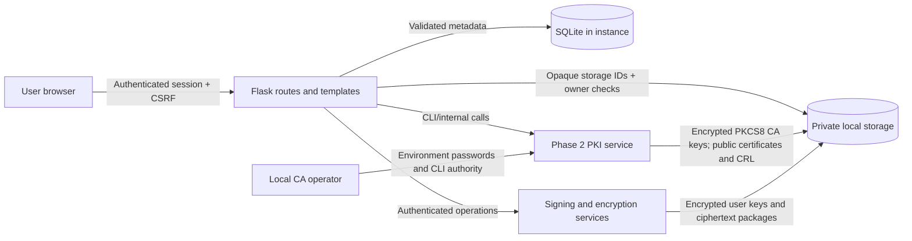
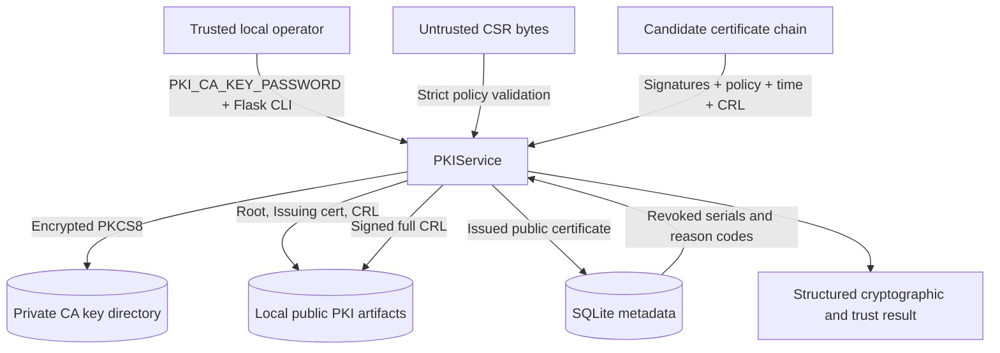
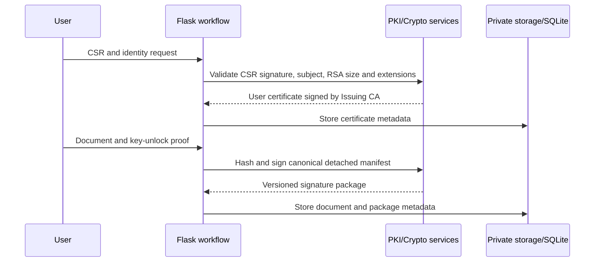
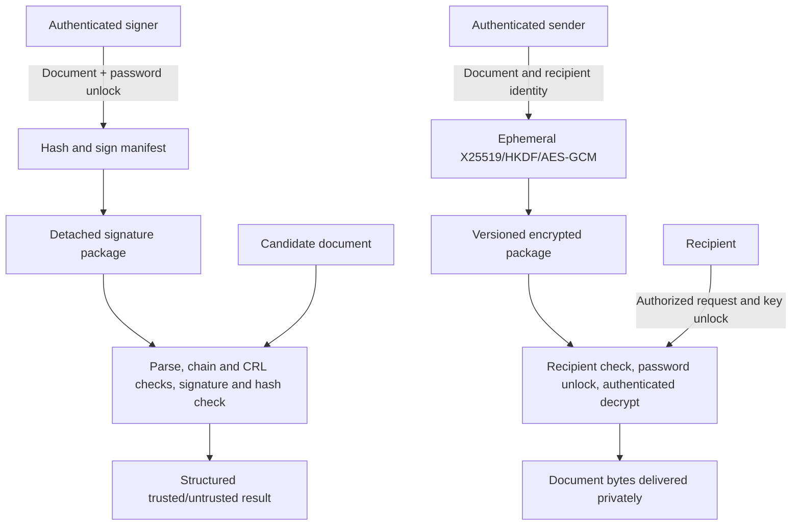

# Architecture and data flow

## Phase 4 implementation boundary

One local Flask process serves Jinja pages and JSON health data. Flask-SQLAlchemy stores metadata in SQLite. Flask-Migrate owns schema changes. The ignored `instance/` directory contains the local database, encrypted CA keys and generated public CA artifacts; it is outside `app/static/`. Phase 2 adds a real internal PKI service and trusted-terminal CLI. It does not add public certificate-management routes.

| Module | Responsibility now | Later phase |
|---|---|---|
| `app/__init__.py`, `config.py`, `extensions.py` | Factory, configuration, extension and private-directory setup | Deployment-specific hardening |
| `app/main/` | Public home and health routes | Production observability |
| `app/auth/` | Registration, login/logout, dashboard, CSRF sessions and bootstrap-admin CLI | Production identity provider/account recovery |
| `app/models/` | Identity, certificate, document, encrypted-package and audit metadata | Production retention controls |
| `app/pki/service.py` | RSA CA hierarchy, CSR policy, issuance, CRL and validation | HSM or externally operated CA integration |
| `app/pki/lifecycle.py` | Public certificate/CSR metadata and revocation persistence | Production lifecycle policy and retention |
| `app/pki/cli.py` | Local operator initialization, development issuance and revocation | Production operator separation |
| `app/documents/service.py` | Canonical RSA-PSS signing and split integrity/trust verification using password-unlocked user keys | Trusted timestamping |
| `app/crypto/` | Scrypt/AES-GCM user-key envelopes and X25519/HKDF/AES-GCM recipient encryption | Recovery, rotation and multi-recipient envelopes |
| `app/documents/`, `app/admin/` | Owner-scoped document workflows and role-protected CA decisions | Production policy/approval separation |

## Components and trust boundaries

The browser-to-Flask boundary uses sessions, CSRF and route-level owner/role checks. The trusted local operator supplies `PKI_CA_KEY_PASSWORD`; the service decrypts a CA key only in process memory for issuance or CRL signing. Generated RSA-3072 CA keys remain encrypted PKCS#8 files separate from password-wrapped user keys. The trust decision anchors only at the configured local Root certificate and checks signatures, subjects/issuers, validity nesting, CA constraints, Key Usage, EKU, SKI/AKI linkage and a current signed CRL. A structurally valid or cryptographically signed certificate is not automatically trusted.

## Implemented certificate and document flows

Phase 3 implements detached verification: it hashes the exact candidate bytes with SHA-256, verifies RSA-PSS/SHA-256 over a canonical manifest, then separately calls the Phase 2 chain/CRL validator. A mathematically valid document signature with a revoked certificate yields an untrusted overall result. Documents are stored as opaque generated identifiers under private runtime storage; filenames are metadata only and PDF/plain-text uploads are size-limited to 16 MiB without content parsing.

Confidential-document sending uses the authenticated sender identity and recipient account's separately stored X25519 public key. Every document gets a new ephemeral X25519 pair, random HKDF salt, HKDF-SHA-256 content key and AES-256-GCM nonce. Canonical metadata is authenticated as AAD and bound into HKDF info. Only the recipient route may load the ciphertext and unlock the recipient private key. The X25519 identity binding is the protected local account/database association rather than a second X.509 certificate; encryption therefore provides confidentiality and recipient binding, not proof of sender authorship.

## Package contracts

Phase 3 defines a version-1 detached signature package: UTF-8 JSON with an explicit `version`, `algorithm`, base64 signature, certificate chain, and a canonical manifest containing SHA-256 digest, certificate fingerprint/serial, and application-recorded signing time. Canonical JSON bytes use sorted keys, compact separators, and UTF-8; unknown fields, duplicate keys and unsupported versions/algorithms fail. The signature covers the canonical manifest bytes.

Phase 4 stores a version-1 encrypted record with algorithm identifier, sender and recipient account IDs, ephemeral X25519 public key, HKDF salt, AES-GCM nonce, safe filename/media metadata and opaque public/storage IDs. Canonical metadata is AES-GCM associated data and is hashed into HKDF info. Ciphertext (including the GCM tag) is stored under an opaque private runtime identifier. Raw paths and private keys are excluded. Encryption alone is not signed and therefore does not claim sender authorship; a sender signs first when origin evidence is required.
